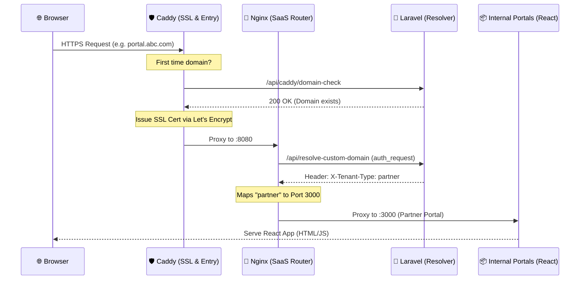

# 🌐 A-Z Multi-Tenant SaaS Infrastructure Guide

This guide provides a step-by-step walkthrough for configuring a highly scalable, multi-tenant SaaS environment with automated SSL (On-Demand TLS), dynamic subdomain routing, and white-label custom domain support.

---

## 📋 Table of Contents
1. [Prerequisites](#1-prerequisites)
2. [Step 1: DNS Configuration](#step-1-dns-configuration)
3. [Step 2: Internal Application Servers (Nginx)](#step-2-internal-application-servers-nginx)
4. [Step 3: The SaaS Router (Nginx)](#step-3-the-saas-router-nginx)
5. [Step 4: The Entry Point & SSL (Caddy)](#step-4-the-entry-point--ssl-caddy)
6. [Step 5: Backend Logic (Laravel)](#step-5-backend-logic-laravel)
7. [Step 6: Verification & Troubleshooting](#step-6-verification--troubleshooting)

---

## 1. Prerequisites
- **OS**: Ubuntu 22.04 or 24.04
- **Web Servers**: Caddy (latest) and Nginx
- **PHP**: PHP 8.3-FPM (for Laravel)
- **Database**: MySQL/MariaDB

---

## 🎨 Visual Request Flow

This diagram shows the "Journey of a Request" from the moment a user types a URL in their browser until the application is served.



### 🛰️ The Journey Step-by-Step

1.  **Browser → Caddy**: The user visits a custom white-label domain or a wildcard subdomain. Caddy terminates the SSL. If it's a new domain, Caddy pauses for a few seconds to issue a Let's Encrypt certificate automatically.
2.  **Caddy → Nginx Router**: Caddy strips the complexity of SSL and forwards a plain HTTP request to Nginx on port 8080.
3.  **Nginx → Laravel (The "Handshake")**: Nginx uses the `auth_request` module. Before it does anything, it sends a partial request to Laravel to identify the tenant.
4.  **Laravel → Nginx**: Laravel looks up the domain in the `partners` table. It returns the "Type" (Partner or Borrower).
5.  **Nginx Port Mapping**: 
    - If `X-Tenant-Type` is **partner**, Nginx sends the user to the **Partner App** (Port 3000).
    - If `X-Tenant-Type` is **borrower**, Nginx sends the user to the **Borrower App** (Port 3001).
6.  **Serving the App**: The target portal serves the index.html and JS files.
7.  **Final Security Layer**: Once the app loads, every API call it makes is double-checked by the `EnsureTenantAccess` middleware in Laravel to ensure absolute isolation.

---

## Step 1: DNS Configuration
To support wildcard subdomains and custom domains, you need the following DNS records:

1.  **Main A Record**: `example.com` -> `SERVER_IP`
2.  **Wildcard A Record**: `*.example.com` -> `SERVER_IP`
3.  **Custom Domains**: White-label partners should point their **CNAME** or **A Record** to your server IP.

---

## Step 2: Internal Application Servers (Nginx)
We host our apps on internal ports so that they are not directly exposed to the internet. Only Caddy/Router can talk to them.

### A. API/Backend (Port 8081)
Config file: `/etc/nginx/sites-available/api-internal`
- Serves the Laravel backend.
- Handles domain resolution logic.

### B. Admin/Partner Portal (Port 3000)
Config file: `/etc/nginx/sites-available/admin-internal`
- Serves the React Partner Portal (`dist` folder).

### C. Client/Borrower Portal (Port 3001)
Config file: `/etc/nginx/sites-available/client-internal`
- Serves the React Borrower Portal (`dist` folder).

---

## Step 3: The SaaS Router (Nginx)
This is the core "logic" layer. It sits between Caddy and your Portals.

**The Magic Logic (`auth_request`):**
Whenever a request arrives, Nginx sends a background request to Laravel to ask: *"Who does this domain belong to?"*

1.  **Request Domain**: `abc.partner.com`
2.  **Nginx** calls Laravel's `/api/resolve-custom-domain`.
3.  **Laravel** checks the database and returns a header `X-Tenant-Type: partner`.
4.  **Nginx** reads that header and sends the user to **Port 3000**.

**Configuration File (`/etc/nginx/sites-available/saas-router`):**
```nginx
map $tenant_type $target_port {
    "partner"  3000;
    "borrower" 3001;
    default    0;
}
# ... see full code section below
```

---

## Step 4: The Entry Point & SSL (Caddy)
Caddy replaces Nginx as the primary gateway because it is superior at handling **Dynamic SSL**.

### Why Caddy?
We use **On-Demand TLS**. When a user visits a *new* custom domain (e.g., `myportal.com`), Caddy:
1.  Asks Laravel: *"Is this domain allowed?"*
2.  If Yes, Caddy automatically downloads and installs an SSL certificate from Let's Encrypt in **real-time**.

**Caddyfile Location**: `/etc/caddy/Caddyfile`

---

## Step 5: Backend Logic (Laravel)
The backend must provide two stateless endpoints (no sessions/cookies).

1.  **`/api/caddy/domain-check`**:
    - Returns `200` if the domain is registered in the `partners` table.
    - Used by Caddy to authorize SSL issuance.
2.  **`/api/resolve-custom-domain`**:
    - Returns the `X-Tenant-Type` and `X-Partner-Id`.
    - Used by Nginx to route the user to the correct app.

---

## Step 6: Verification & Troubleshooting

### How to test:
1.  **Curl Test**: `curl -H "Host: yourdomain.com" http://127.0.0.1:8080`
    - Check if Nginx returns the correct portal HTML.
2.  **SSL Test**: Visit the domain in a browser. Caddy should issue a certificate within 5-10 seconds on the first visit.

### Logs to watch:
- **Caddy Errors**: `journalctl -u caddy -f`
- **Laravel Resolution**: `tail -f storage/logs/laravel.log`
- **Nginx Routing**: `tail -f /var/log/nginx/error.log`

---

## 📂 Appendix: Full Configuration Code

This section contains the **exact, raw code** currently running on the server.

### 1. Caddy Configuration (`/etc/caddy/Caddyfile`)
<details>
<summary>Click to view full Caddyfile</summary>

```caddy
{
    email awladdeleo@gmail.com
    on_demand_tls {
        ask    http://127.0.0.1:8081/api/caddy/domain-check
    }
}

# skylinedynamic.dev (Marketing Website)
skylinedynamic.dev {
    encode gzip
    handle /phpmyadmin* { reverse_proxy 127.0.0.1:8083 }
    handle { reverse_proxy 127.0.0.1:3002 }
}

# API — Laravel backend
api.skylinedynamic.dev {
    encode gzip
    reverse_proxy 127.0.0.1:8081 {
        header_up Host {host}
        header_up X-Real-IP {remote_host}
        header_up X-Forwarded-For {remote_host}
        header_up X-Forwarded-Proto {scheme}
    }
}

# Admin portal (React)
admin.skylinedynamic.dev {
    encode gzip
    reverse_proxy 127.0.0.1:3000 {
        header_up Host {host}
        header_up X-Real-IP {remote_host}
    }
}

# Client/borrower portal (React)
client.skylinedynamic.dev {
    encode gzip
    reverse_proxy 127.0.0.1:3001 {
        header_up Host {host}
        header_up X-Real-IP {remote_host}
    }
}

# CATCH-ALL BLOCK for Dynamic Domains
:443 {
    tls { on_demand }
    encode gzip
    reverse_proxy 127.0.0.1:8080 {
        header_up Host              {host}
        header_up X-Real-IP         {remote_host}
        header_up X-Forwarded-For   {remote_host}
        header_up X-Forwarded-Proto {scheme}
    }
}

:80 {
    redir https://{host}{uri} permanent
}
```
</details>

### 2. Nginx: SaaS Router (`saas-router`)
<details>
<summary>Click to view full saas-router config</summary>

```nginx
map $tenant_type $target_port {
    "partner"  3000;
    "borrower" 3001;
    default    0;
}

server {
    listen 127.0.0.1:8080;
    server_name _;
    server_tokens off;

    location = /_tenant-resolver {
        internal;
        proxy_pass              http://127.0.0.1:8081/api/resolve-custom-domain;
        proxy_pass_request_body off;
        proxy_set_header        Content-Length  "";
        proxy_set_header        X-Domain        $host;
        proxy_set_header        X-Internal-Key  "fourcornerfunding2026";
        proxy_set_header        Host            "127.0.0.1";
        proxy_pass_header       X-Tenant-Type;
        proxy_pass_header       X-Partner-Id;
    }

    location / {
        auth_request     /_tenant-resolver;
        auth_request_set $tenant_type $upstream_http_x_tenant_type;
        auth_request_set $partner_id  $upstream_http_x_partner_id;
        
        error_page 401 = @error_server;
        
        proxy_pass         http://127.0.0.1:$target_port;
        proxy_set_header   Host              $host;
        proxy_set_header   X-Real-IP         $remote_addr;
        proxy_set_header   X-Forwarded-For   $proxy_add_x_forwarded_for;
        proxy_set_header   X-Forwarded-Proto $scheme;
        proxy_set_header   X-Tenant-Type     $tenant_type;
        proxy_set_header   X-Partner-Id      $partner_id;
        proxy_http_version 1.1;
        proxy_set_header   Upgrade           $http_upgrade;
        proxy_set_header   Connection        "upgrade";
    }
}
```
</details>

### 3. Nginx: Internal Portals
<details>
<summary>Click to view Internal Port Configs (Admin, Client, API, Website)</summary>

#### Admin Internal (Port 3000)
```nginx
server {
    listen 127.0.0.1:3000;
    server_name _;
    root /var/www/html/admin-portal-react/dist;
    index index.html;
    location / { try_files $uri /index.html; }
}
```

#### Client Internal (Port 3001)
```nginx
server {
    listen 127.0.0.1:3001;
    server_name _;
    root /var/www/html/client-portal-react/dist;
    index index.html;
    location / { try_files $uri /index.html; }
}
```

#### API Internal (Port 8081)
```nginx
server {
    listen 127.0.0.1:8081;
    server_name _;
    root /var/www/html/fch-api/public;
    index index.php;
    location / { try_files $uri $uri/ /index.php?$query_string; }
    location ~ \.php$ {
        include snippets/fastcgi-php.conf;
        fastcgi_pass unix:/var/run/php/php8.3-fpm.sock;
    }
}
```

#### Website Internal (Port 3002)
```nginx
server {
    listen 127.0.0.1:3002;
    server_name _;
    location / {
        proxy_pass http://127.0.0.1:3003; # Next.js
        proxy_http_version 1.1;
        proxy_set_header Upgrade $http_upgrade;
        proxy_set_header Connection "upgrade";
    }
}
```
</details>
