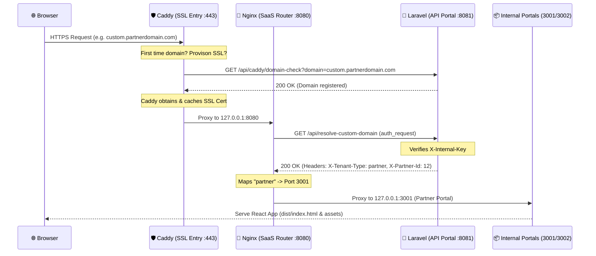

# 🌐 Production Multi-Tenant SaaS Infrastructure Guide

This guide provides a comprehensive documentation of the production multi-tenant SaaS environment for **Four Corner Holding** (`fourcornerfunding.com`). It outlines the architecture, routing layers, configurations, and verification steps for automated SSL (On-Demand TLS), dynamic subdomain routing, and white-label custom domain support.

---

## 📋 Table of Contents
1. [Architecture Overview](#architecture-overview)
2. [Visual Request Flow](#-visual-request-flow)
3. [Step 1: DNS Configuration](#step-1-dns-configuration)
4. [Step 2: Internal Application Servers (Nginx)](#step-2-internal-application-servers-nginx)
5. [Step 3: The SaaS Router (Nginx)](#step-3-the-saas-router-nginx)
6. [Step 4: The Entry Point & SSL (Caddy)](#step-4-the-entry-point--ssl-caddy)
7. [Step 5: Backend Logic & Resolution (Laravel)](#step-5-backend-logic--resolution-laravel)
8. [Step 6: Troubleshooting & Logs](#step-6-troubleshooting--logs)
9. [📂 Appendix: Full Production Configuration Code](#-appendix-full-production-configuration-code)

---

## Architecture Overview

In production, the infrastructure splits traffic handling into three tiers to guarantee security, scalability, and ease of SSL management:
1.  **Caddy (The Gatekeeper / SSL Layer)**: Listens on public ports `80`/`443`. It handles automated Let's Encrypt certificates via **On-Demand TLS** and proxies traffic to Nginx.
2.  **Nginx SaaS Router (The Traffic Controller)**: Listens internally on port `8080`. It uses the Nginx `auth_request` module to query Laravel on-the-fly, dynamically determining the tenant and proxying the user to the correct internal React portal port.
3.  **Internal App Servers (The Content Creators)**: Nginx processes listening on local loopback ports serving the React portals and the Laravel API directly.

---

## 🎨 Visual Request Flow

This diagram illustrates the **Journey of a Request** in the production environment from the client's browser through SSL provisioning, tenant validation, and port redirection.



### 🛰️ The Journey Step-by-Step

1.  **Browser → Caddy**: A client hits either a wildcard subdomain (e.g., `acme.fourcornerfunding.com`) or a white-label custom domain (e.g., `partnerportal.com`).
2.  **On-Demand TLS Handshake**:
    - If Caddy does not have an active SSL certificate for this domain, it calls the `ask` endpoint: `http://127.0.0.1:8081/api/caddy/domain-check?domain=...`.
    - Laravel replies with `200 OK` if the domain belongs to a registered partner.
    - Caddy requests a certificate from Let's Encrypt in real-time, completes the TLS handshake, and caches the certificate.
3.  **Caddy → Nginx Router**: Caddy proxies the decrypted traffic to the Nginx SaaS Router listening locally on `127.0.0.1:8080`.
4.  **SaaS Router Verification**:
    - Nginx triggers the `auth_request` location `/ _tenant-resolver` which fires a subrequest to Laravel's `/api/resolve-custom-domain`.
    - It sends the current domain (`$host`) and the production verification key (`X-Internal-Key: fourcornerfunding2026`).
5.  **Tenant Response**: Laravel validates the internal key, queries the database, and returns custom headers:
    - `X-Tenant-Type`: `partner` or `borrower`.
    - `X-Partner-Id`: The database ID of the matching partner.
6.  **Dynamic Proxy Routing**:
    - If `X-Tenant-Type` is `partner`, Nginx maps it to port `3001` (Partner Portal React build).
    - If `X-Tenant-Type` is `borrower`, Nginx maps it to port `3002` (Client/Borrower Portal React build).
7.  **Client Loading**: The targeted internal port serves the React single-page application resources.

---

## Step 1: DNS Configuration
For multi-tenancy and white-label custom domains to resolve to the production instance, configure the following:

1.  **Wildcard A Record**:
    - Record: `*.fourcornerfunding.com` -> Points to production server IP.
    - Resolves all custom subdomains (e.g. `tenant1.fourcornerfunding.com`, `admin.fourcornerfunding.com`).
2.  **Root & API Records**:
    - `fourcornerfunding.com` -> Points to production server IP.
    - `api.fourcornerfunding.com` -> Points to production server IP.
    - `partner.fourcornerfunding.com` -> Points to production server IP.
    - `app.fourcornerfunding.com` -> Points to production server IP.
3.  **Custom White-Label Domains**:
    - White-label partners configure their DNS to point to your server IP via an **A Record** or **CNAME** pointing to `fourcornerfunding.com`.

---

## Step 2: Internal Application Servers (Nginx)
Production apps run on internal loopback ports, shielded from direct public access.

### A. API / Backend Portal (Port 8081)
- **Config Path**: `/etc/nginx/sites-available/api-internal`
- **Root Directory**: `/var/www/html/api-portal/public`
- **Socket**: PHP 8.3-FPM (`unix:/var/run/php/php8.3-fpm.sock`)
- **Important**: Ignores `X-Accel-Redirect` headers from Laravel to prevent circular redirect loops.

### B. Partner Portal (Port 3001)
- **Config Path**: `/etc/nginx/sites-available/admin-internal`
- **Root Directory**: `/var/www/html/partner-portal/dist`
- **Type**: React SPA (compiled files with caching rules for assets).

### C. Client/Borrower Portal (Port 3002)
- **Config Path**: `/etc/nginx/sites-available/client-internal`
- **Root Directory**: `/var/www/html/client-portal/dist`
- **Type**: React SPA (compiled files with caching rules for assets).

---

## Step 3: The SaaS Router (Nginx)
The router is the intermediate dispatcher layer that reads Laravel's resolution headers and routes requests to the correct internal port.

- **Config Path**: `/etc/nginx/sites-available/saas-router`
- **Listen Port**: `127.0.0.1:8080`
- **Map Definition**:
  ```nginx
  map $tenant_type $target_port {
      "partner"  3001;
      "borrower" 3002;
      default    0;
  }
  ```
- **Authentication Key**: Nginx sets `X-Internal-Key "fourcornerfunding2026"` in the subrequest to Laravel, matching `config('domains.internal_key')`.

---

## Step 4: The Entry Point & SSL (Caddy)
Caddy serves as the public entry gateway. It coordinates On-Demand TLS for custom domains and proxies traffic to either static configurations (like the marketing website or API) or the SaaS router.

- **Config Path**: `/etc/caddy/Caddyfile`
- **On-Demand Configuration**:
  ```caddy
  on_demand_tls {
      ask      http://127.0.0.1:8081/api/caddy/domain-check
      interval 2m
      burst    5
  }
  ```
- **Routing Rules**:
  - `fourcornerfunding.com` -> Proxy to `127.0.0.1:3000` (Marketing Website)
  - `api.fourcornerfunding.com` -> Proxy to `127.0.0.1:8081` (Laravel Backend)
  - `partner.fourcornerfunding.com` -> Proxy to `127.0.0.1:3001` (Partner Portal)
  - `app.fourcornerfunding.com` -> Proxy to `127.0.0.1:3002` (Borrower/Client Portal)
  - Catch-All `:443` -> Proxy to `127.0.0.1:8080` (SaaS Router with `on_demand` SSL)

---

## Step 5: Backend Logic & Resolution (Laravel)
The Laravel backend exposes two stateless verification routes in `routes/api.php` handled by [DomainResolverController](file:///c:/laragon/www/fch-api/app/Http/Controllers/DomainResolverController.php):

1.  **Caddy Domain Validator (`/api/caddy/domain-check`)**:
    - Validates whether Caddy should issue/renew an SSL certificate for a requested domain.
    - Wildcard subdomains of the base website (e.g. `*.fourcornerfunding.com`) are automatically allowed.
    - Custom domains are verified against the database.
2.  **Tenant Resolver (`/api/resolve-custom-domain`)**:
    - Validates the internal key (`X-Internal-Key`).
    - Resolves the tenant's type (`partner` or `borrower`) and `partner_id` by matching the database fields `partner_domain`, `partner_subdomain`, or `borrower_domain`.
    - Returns HTTP `200` with headers `X-Tenant-Type` and `X-Partner-Id`.

---

## Step 6: Troubleshooting & Logs

To diagnose issues where subdomains or custom domains are not working, follow this checklist:

### A. Monitor Detailed Resolution Logs
Detailed debug logs have been added to [DomainResolverController](file:///c:/laragon/www/fch-api/app/Http/Controllers/DomainResolverController.php) to track the flow of every domain-check and tenant-resolution query.

Monitor these logs in real-time on the server:
```bash
tail -f storage/logs/laravel.log
```

**Look for logs starting with:**
- `[DomainResolver:resolve]`
- `[DomainResolver:caddyCheck]`

#### Examples of Log Messages to Trace Errors:
*   **Internal Key Error**:
    `[DomainResolver:resolve] Internal key mismatch.`
    *Solution*: Verify that the key in `/etc/nginx/sites-available/saas-router` (`fourcornerfunding2026`) matches the key set in your Laravel `.env` (`DOMAINS_INTERNAL_KEY`).
*   **Database Match Failure**:
    `[DomainResolver:resolve] No match found in database.`
    *Solution*: Double check if the subdomain or custom domain is saved under `partner_subdomain`, `partner_domain`, or `borrower_domain` in the database, and that there are no trailing whitespaces or uppercase mismatch issues.
*   **Caddy Query Interception**:
    `[DomainResolver:caddyCheck] Domain matches base website subdomain check, returning OK.`
    *Solution*: If subdomains of `fourcornerfunding.com` fail this check, ensure your `.env` contains `APP_BASE_WEBSITE=fourcornerfunding.com` (which sets `config('app.base_website')`).

### B. Checking Server Process Logs
*   **Caddy SSL Issuance Logs**:
    ```bash
    sudo journalctl -u caddy -f
    ```
    Look here if Caddy fails to fetch or renew a certificate. Look for TLS handshake timeouts or Let's Encrypt rate-limiting warnings.
*   **Nginx Error Logs**:
    ```bash
    tail -f /var/log/nginx/error.log
    ```
    If Nginx returns `503 Tenant resolver error`, check here. It usually indicates Nginx is unable to connect to the upstream Laravel server (`127.0.0.1:8081`) or the routing ports (`3001` or `3002`).

### C. Testing Endpoints Manually
Verify endpoints locally from the command line using `curl`:

1.  **Test Domain Resolution Handler directly**:
    ```bash
    curl -I -H "X-Domain: partner.fourcornerfunding.com" -H "X-Internal-Key: fourcornerfunding2026" http://127.0.0.1:8081/api/resolve-custom-domain
    ```
    *Expected output*: HTTP 200 with headers:
    `X-Tenant-Type: partner`
    `X-Partner-Id: <id>`
2.  **Test Caddy Check handler**:
    ```bash
    curl -i "http://127.0.0.1:8081/api/caddy/domain-check?domain=partner.fourcornerfunding.com"
    ```
    *Expected output*: `HTTP/1.1 200 OK` with response body `OK`.
3.  **Test SaaS Router routing logic**:
    ```bash
    curl -I -H "Host: partner.fourcornerfunding.com" http://127.0.0.1:8080
    ```
    *Expected output*: Inspect the headers. It should show:
    `X-Debug-Tenant: partner`
    `X-Debug-Port: 3001`

---

## 📂 Appendix: Full Production Configuration Code

### 1. Caddy Configuration (`/etc/caddy/Caddyfile`)
<details>
<summary>Click to view full Production Caddyfile</summary>

```caddy
{
    email awladdeleo@gmail.com
    on_demand_tls {
        ask        http://127.0.0.1:8081/api/caddy/domain-check
        interval 2m
        burst 5
    }
}

fourcornerfunding.com {
    encode gzip
    handle /phpmyadmin* {
        reverse_proxy 127.0.0.1:8083
    }
    handle {
        reverse_proxy 127.0.0.1:3000
    }
}
www.fourcornerfunding.com {
    redir https://fourcornerfunding.com{uri} permanent
}

api.fourcornerfunding.com {
    encode gzip
    request_body {
        max_size 100MB
    }
    handle {
        reverse_proxy 127.0.0.1:8081 {
            header_up Host              {host}
            header_up X-Real-IP         {remote_host}
            header_up X-Forwarded-For   {remote_host}
            header_up X-Forwarded-Proto {scheme}
        }
    }
}
www.api.fourcornerfunding.com {
    redir https://api.fourcornerfunding.com{uri} permanent
}

partner.fourcornerfunding.com {
    encode gzip
    reverse_proxy 127.0.0.1:3001 {
        header_up Host      {host}
        header_up X-Real-IP {remote_host}
    }
}
www.partner.fourcornerfunding.com {
    redir https://partner.fourcornerfunding.com{uri} permanent
}

app.fourcornerfunding.com {
    encode gzip
    reverse_proxy 127.0.0.1:3002 {
        header_up Host      {host}
        header_up X-Real-IP {remote_host}
    }
}
www.app.fourcornerfunding.com {
    redir https://app.fourcornerfunding.com{uri} permanent
}

# CATCH-ALL BLOCK for Dynamic/White-Label Domains
:443 {
    tls {
        on_demand
    }
    encode gzip
    reverse_proxy 127.0.0.1:8080 {
        header_up Host              {host}
        header_up X-Real-IP         {remote_host}
        header_up X-Forwarded-For   {remote_host}
        header_up X-Forwarded-Proto {scheme}
    }
}
:80 {
    redir https://{host}{uri} permanent
}
```
</details>

### 2. Nginx: SaaS Router (`saas-router`)
<details>
<summary>Click to view full Production saas-router config</summary>

```nginx
map $tenant_type $target_port {
    "partner"  3001;
    "borrower" 3002;
    default    0;
}

server {
    listen 127.0.0.1:8080;
    server_name _;
    server_tokens off;

    location = /_tenant-resolver {
        internal;
        proxy_pass              http://127.0.0.1:8081/api/resolve-custom-domain;
        proxy_pass_request_body off;
        proxy_set_header        Content-Length  "";
        proxy_set_header        X-Domain        $host;
        proxy_set_header        X-Internal-Key  "fourcornerfunding2026";
        proxy_set_header        Host            "127.0.0.1";
        proxy_pass_header       X-Tenant-Type;
        proxy_pass_header       X-Partner-Id;
    }

    location / {
        auth_request     /_tenant-resolver;
        auth_request_set $tenant_type $upstream_http_x_tenant_type;
        auth_request_set $partner_id  $upstream_http_x_partner_id;

        error_page 401 = @error_server;

        proxy_pass         http://127.0.0.1:$target_port;
        proxy_set_header   Host              $host;
        proxy_set_header   X-Real-IP         $remote_addr;
        proxy_set_header   X-Forwarded-For   $proxy_add_x_forwarded_for;
        proxy_set_header   X-Forwarded-Proto $scheme;
        proxy_set_header   X-Tenant-Type     $tenant_type;
        proxy_set_header   X-Partner-Id      $partner_id;
        proxy_http_version 1.1;
        proxy_set_header   Upgrade           $http_upgrade;
        proxy_set_header   Connection        "upgrade";
        add_header         X-Debug-Tenant    $tenant_type always;
        add_header         X-Debug-Port      $target_port always;
    }

    location @error_server {
        return 503 "Tenant resolver error";
    }
}
```
</details>

### 3. Nginx: Internal Portals
<details>
<summary>Click to view Production Internal Port Configs (Admin, Client, API)</summary>

#### API Internal (Port 8081) - `/etc/nginx/sites-available/api-internal`
```nginx
server {
    listen 127.0.0.1:8081;
    server_name _;
    root /var/www/html/api-portal/public;
    index index.php index.html;
    client_max_body_size 100M;

    location / {
        try_files $uri $uri/ /index.php?$query_string;
    }

    location ~ \.php$ {
        include snippets/fastcgi-php.conf;
        fastcgi_pass unix:/var/run/php/php8.3-fpm.sock;
        fastcgi_param SCRIPT_FILENAME $document_root$fastcgi_script_name;
        include fastcgi_params;

        # Disable X-Accel-Redirect processing — prevents redirect loop
        # when Laravel returns X-Accel-Redirect header
        fastcgi_ignore_headers X-Accel-Redirect X-Accel-Expires X-Accel-Limit-Rate X-Accel-Buffering X-Accel-Charset;
    }

    location ~ /\.ht {
        deny all;
    }
}
```

#### Admin/Partner Internal (Port 3001) - `/etc/nginx/sites-available/admin-internal`
```nginx
server {
    listen 127.0.0.1:3001;
    server_name _;
    root /var/www/html/partner-portal/dist;
    index index.html;

    location / {
        try_files $uri /index.html;
    }

    location ~* \.(js|css|png|jpg|jpeg|gif|ico|svg|woff|woff2|ttf|eot)$ {
        expires 1y;
        add_header Cache-Control "public, immutable";
        try_files $uri =404;
    }
}
```

#### Client Internal (Port 3002) - `/etc/nginx/sites-available/client-internal`
```nginx
server {
    listen 127.0.0.1:3002;
    server_name _;
    root /var/www/html/client-portal/dist;
    index index.html;

    location / {
        try_files $uri /index.html;
    }

    location ~* \.(js|css|png|jpg|jpeg|gif|ico|svg|woff|woff2|ttf|eot)$ {
        expires 1y;
        add_header Cache-Control "public, immutable";
        try_files $uri =404;
    }
}
```
</details>
