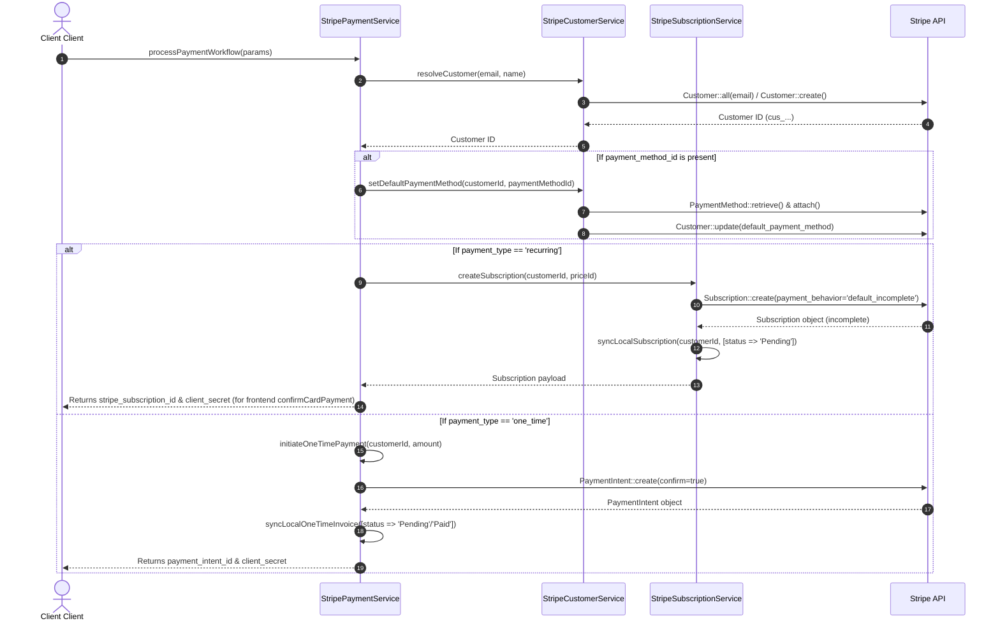
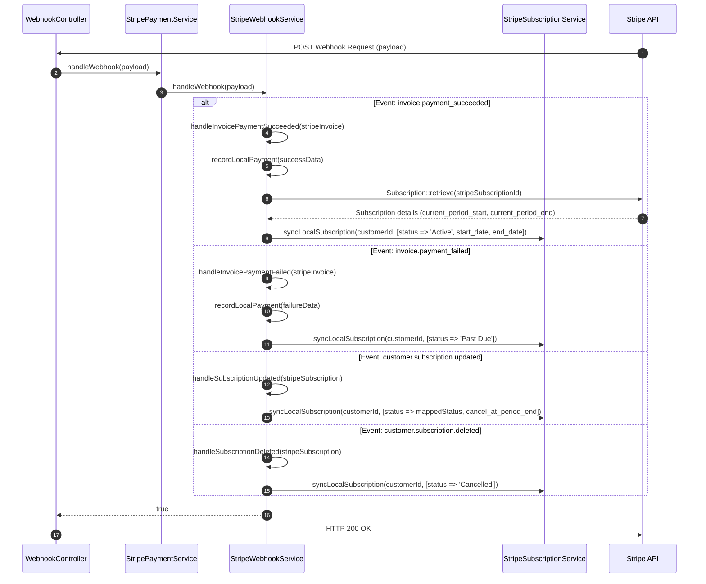

# Stripe Subscription & Webhook Flow Documentation

This document describes the design, implementation, and sequence of method calls for managing Stripe customer sessions, subscription life cycles (e.g. 6-monthly cycles), one-time invoices, and database synchronization via Stripe Webhook events.

---

## 1. Class Architectures & Method Details

We split the payment implementation into four modular classes under `App\Services\GlobalPayment`:

```
app/Services/GlobalPayment/
├── StripePaymentService.php                 <- Primary Facade/Orchestrator
└── Stripe/
    ├── StripeCustomerService.php           <- Customer setup & Payment Method binding
    ├── StripeSubscriptionService.php       <- Subscription creation & synchronization
    └── StripeWebhookService.php            <- Webhook payload dispatch & database parsing
```

---

### Class A: `StripePaymentService`
The orchestrator/facade that exposes the client API.

#### Method 1: `processPaymentWorkflow(array $params): array`
* **Purpose**: Coordinates the entry checkout workflow. Resolves customer details, binds cards, and branches payment actions.
* **Flow**:
  1. Calls `StripeCustomerService::resolveCustomer()` to find/create the Stripe Customer.
  2. If `payment_method_id` is provided, calls `StripeCustomerService::setDefaultPaymentMethod()` to register card details.
  3. If `payment_type` is `'recurring'`, calls `StripeSubscriptionService::createSubscription()`.
  4. If `payment_type` is `'one_time'`, calls internal helper `initiateOneTimePayment()`.
* **Params**: `email`, `name`, `payment_method_id`, `payment_type`, `stripe_price_id` (recurring), `amount` (one-time).
* **Returns**: Array with transaction IDs, status codes, and `client_secret` (needed for client-side SCA popup if 3DS authentication is required).

#### Method 2: `handleWebhook(array $payload): bool`
* **Purpose**: Simple entry handler to route webhook request payloads.
* **Flow**: Passes `$payload` to `StripeWebhookService::handleWebhook()`.

#### Method 3: `initiateOneTimePayment(string $customerId, float $amount, string $currency): array`
* **Purpose**: Processes a one-off charge using a Payment Intent.
* **Flow**:
  1. Requests `Stripe\PaymentIntent::create()` with `confirm => true`.
  2. Invokes local helper `syncLocalOneTimeInvoice()` to save status as "Pending" or "Paid" depending on checkout confirmation.
* **Returns**: Array containing `payment_intent_id`, `status`, and frontend authentication `client_secret`.

---

### Class B: `StripeCustomerService`
Manages customer entities and Stripe account parameters.

#### Method 1: `resolveCustomer(string $email, string $name, ?string $stripeCustomerId = null): string`
* **Purpose**: Resolves the Stripe Customer ID by prioritizing local database IDs, falling back to Stripe email lookup, or creating a new profile.
* **Flow**:
  1. Checks if a local `$stripeCustomerId` is provided. If so, immediately returns it.
  2. If not, queries Stripe with `Stripe\Customer::all(['email' => $email])`.
  3. If a match is found, returns that Customer ID.
  4. Otherwise, calls `Stripe\Customer::create()` to generate a new customer and returns the new ID.
* **Returns**: String `customerId` (e.g. `cus_...`).

#### Method 2: `setDefaultPaymentMethod(string $customerId, string $paymentMethodId): void`
* **Purpose**: Attaches the source token card to the customer profile.
* **Flow**:
  1. Checks if the payment method is already attached to this customer.
  2. If not, invokes `$paymentMethod->attach(['customer' => $customerId])`.
  3. Calls `Stripe\Customer::update($customerId, ['invoice_settings' => ['default_payment_method' => $paymentMethodId]])` so future subscription invoice billing attempts charge this card automatically.

---

### Class C: `StripeSubscriptionService`
Manages setup of recurring subscriptions.

#### Method 1: `createSubscription(string $customerId, string $priceId): array`
* **Purpose**: Requests subscription creation on Stripe.
* **Flow**:
  1. Invokes `Stripe\Subscription::create()` with `payment_behavior => 'default_incomplete'` (critical to support 3D Secure checkout flows).
  2. Invokes local helper method `syncLocalSubscription()` to write a localized pending subscription in the DB.
* **Returns**: Array containing `stripe_subscription_id`, subscription status (`incomplete` initially), the first invoice `client_secret`, and `invoice_id`.

#### Method 2: `syncLocalSubscription(string $stripeCustomerId, array $data): void`
* **Purpose**: Writes subscription parameters, dates, status, or cancellation schedules to the local database.

---

### Class D: `StripeWebhookService`
Handles asynchronous synchronization from Stripe.

#### Method 1: `handleWebhook(array $payload): bool`
* **Purpose**: Acts as a dispatcher, checking `$payload['type']` and calling event-specific handler methods.
* **Routes**:
  * `'invoice.payment_succeeded'` -> `handleInvoicePaymentSucceeded()`
  * `'invoice.payment_failed'` -> `handleInvoicePaymentFailed()`
  * `'customer.subscription.updated'` -> `handleSubscriptionUpdated()`
  * `'customer.subscription.deleted'` -> `handleSubscriptionDeleted()`

#### Method 2: `handleInvoicePaymentSucceeded(array $stripeInvoice): void`
* **Purpose**: Extends subscription validity and registers invoice receipts.
* **Flow**:
  1. If invoice contains a subscription ID, invokes `recordLocalPayment()` for audit trail.
  2. Queries Stripe API (`Stripe\Subscription::retrieve()`) to fetch exact cycle bounds (`current_period_start`, `current_period_end`).
  3. Calls `StripeSubscriptionService::syncLocalSubscription()` to extend the local subscription valid range and mark status as `Active`.
  4. If no subscription exists on the invoice, calls `updateLocalOneTimeInvoice()` to mark the one-time payment as `Paid`.

#### Method 3: `handleInvoicePaymentFailed(array $stripeInvoice): void`
* **Purpose**: Captures failed recurring card updates.
* **Flow**:
  1. Invokes `recordLocalPayment()` mapping failure details (`failure_reason`).
  2. If subscription-linked, calls `StripeSubscriptionService::syncLocalSubscription()` updating status to `Past Due` to lock user features.

#### Method 4: `handleSubscriptionUpdated(array $stripeSubscription): void`
* **Purpose**: Responds to plan modifications, trials ending, or cancels.
* **Flow**: Maps Stripe subscription status strings (`active`, `trialing`, `past_due`, `unpaid`, `canceled`) to application terms and calls `syncLocalSubscription()`.

#### Method 5: `handleSubscriptionDeleted(array $stripeSubscription): void`
* **Purpose**: Hard termination of user contracts.
* **Flow**: Sets local subscription status to `Cancelled` and stores the cancellation timestamp.

---

## 2. Process Sequence Diagrams

### Setup & Initial Checkout Flow
The process flow of method invocation when a customer initiates payment from the frontend:



---

### Webhook Event Processing Flow
The sequence of methods invoked when Stripe pushes an event to our `/stripe/webhook` route:


